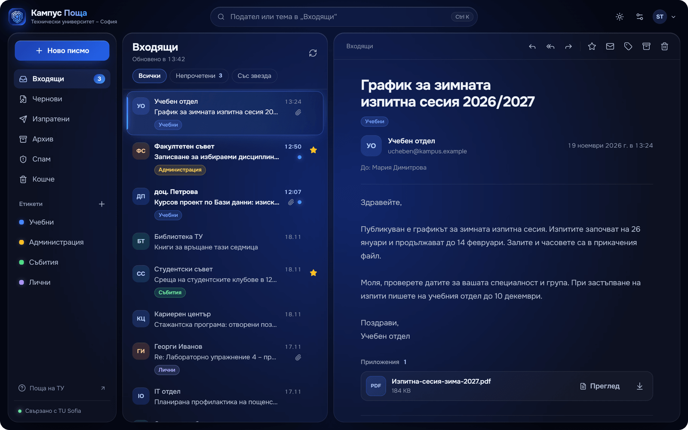
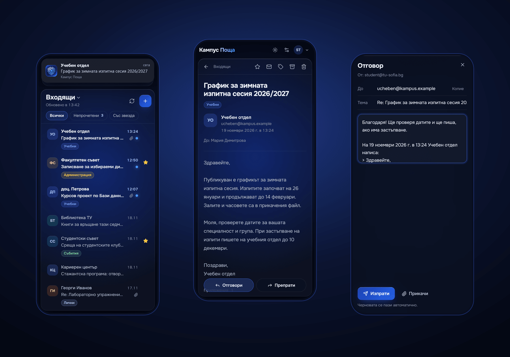
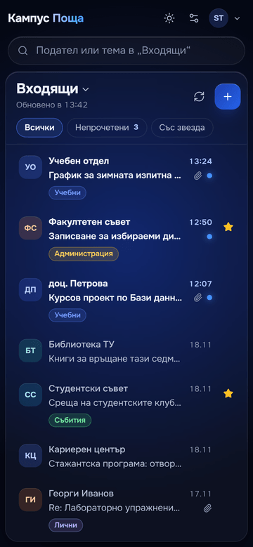
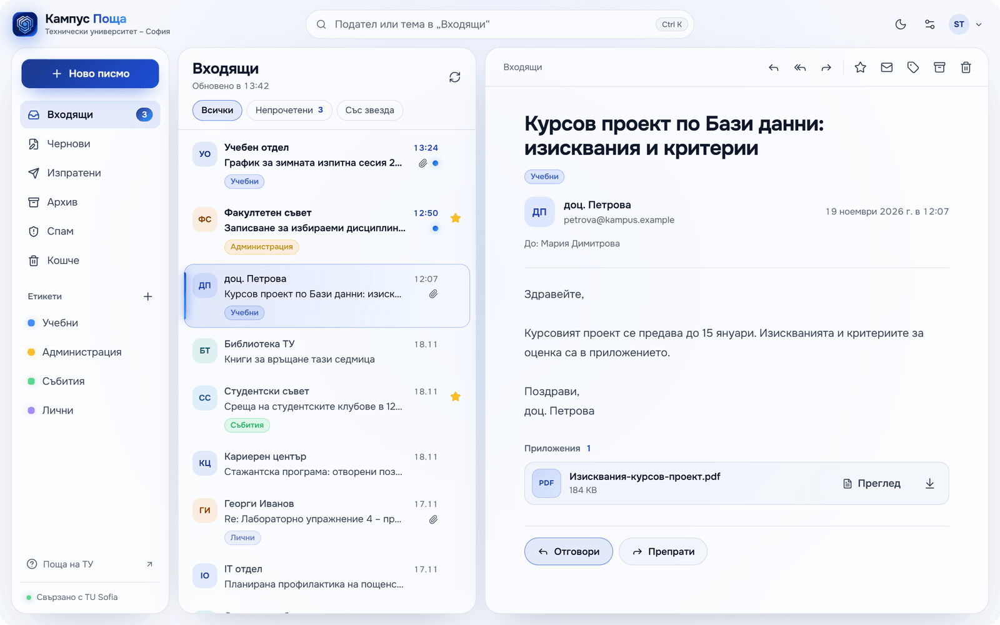
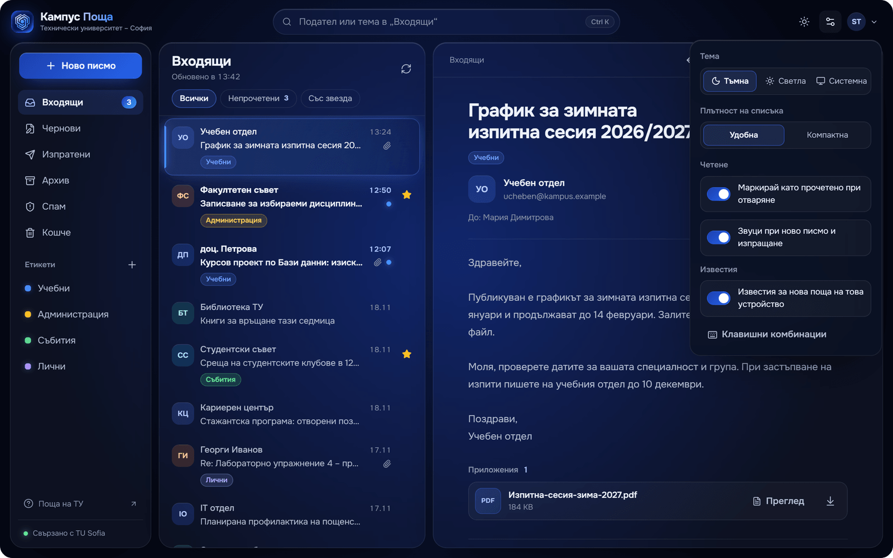
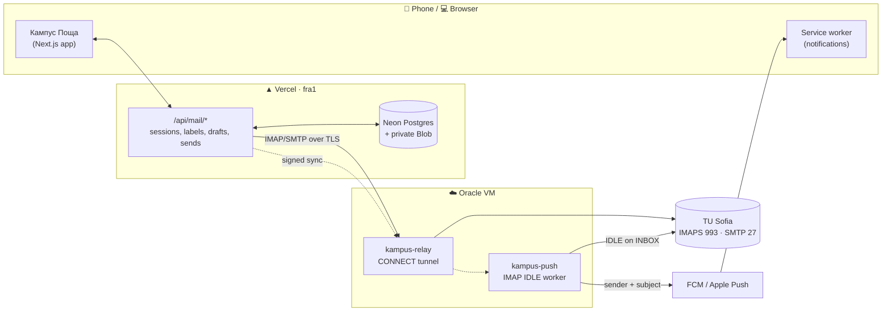

<p align="center">
  
</p>

<p align="center">
  <a href="https://github.com/sixfiguredev0/kampus-posta/releases/tag/v1.0.0"></a>
  
  
  
  
</p>

<p align="center">
  <b>A fast, focused mail client for TU Sofia mailboxes</b>, with a Bulgarian interface, dark mode by default,<br />
  a phone-first layout and new-mail notifications on your phone.<br /><br />
  <a href="https://kampus-posta.vercel.app"><b>Open Кампус Поща →</b></a>
</p>

<p align="center">
  
</p>

> Every screenshot and animation in this README uses **fictional mail**. No real mailbox was shown.

---

## ✨ What it does

<table>
  <tr>
    <td width="50%" valign="top">
      <h3>📬 Reading that respects TU</h3>
      Folders show TU's real unread counts. Opening a message marks it read in TUSmail, or not, if you turn that off. Search covers sender and subject in the current folder. The list refreshes on entry, on focus and about every minute.
    </td>
    <td width="50%" valign="top">
      <h3>🗂️ Organising in one tap</h3>
      Stars, read/unread, move, archive and trash, one message at a time or in bulk. Every move has an <b>8-second undo</b>. Permanent delete only from Кошче, after a confirmation.
    </td>
  </tr>
  <tr>
    <td valign="top">
      <h3>🏷️ Labels</h3>
      Учебни, Администрация, Събития, Лични, plus your own. Labels are keyed by Message-ID, so they follow a message you move within the app.
    </td>
    <td valign="top">
      <h3>✉️ Sending you can trust</h3>
      Reply, reply all, forward, CC/BCC, attachments and autosaved drafts. Every send has a stable attempt ID: an uncertain SMTP result is <b>never resent automatically</b>, and <b>Запази копие</b> retries only the Sent copy.
    </td>
  </tr>
  <tr>
    <td valign="top">
      <h3>🔔 Notifications on your phone</h3>
      New mail in Входящи arrives as a notification with the sender and subject, even when the app is closed. Battery use is close to zero: the phone keeps no mail connection of its own.
    </td>
    <td valign="top">
      <h3>🎧 Small touches</h3>
      Optional sounds for new mail and for sending (made with ElevenLabs), dark/light/system themes, comfortable or compact density, and <code>?</code> for every keyboard shortcut.
    </td>
  </tr>
</table>

## 📱 Made for the phone

<p align="center">
  
</p>

<table>
  <tr>
    <td width="36%" align="center"></td>
    <td valign="middle">
      <ul>
        <li>The list and the message switch smoothly, and <b>Back</b> returns to exactly where you were.</li>
        <li><b>Add to Home Screen</b> installs it like an app, with the Кампус Поща icon.</li>
        <li>Turn on <b>Известия за нова поща</b> in Settings, separately on each device.</li>
        <li>On iPhone, notifications work once the app is added to the Home Screen (iOS 16.4+).</li>
        <li>Tapping a notification opens that exact message.</li>
      </ul>
    </td>
  </tr>
</table>

## 🌗 Your way

<table>
  <tr>
    <td width="50%"></td>
    <td width="50%"></td>
  </tr>
  <tr>
    <td align="center"><sub>Light theme</sub></td>
    <td align="center"><sub>Settings: theme, density, reading, sounds, notifications</sub></td>
  </tr>
</table>

---

## 🧭 How it works



- **TU drops all traffic from AWS**, which is where Vercel runs. Mail sockets therefore pass through a small, dependency-free CONNECT relay on an Oracle VM. The relay only allows TU's two mail endpoints, and TLS runs end to end, so it never sees mail or passwords.
- **Notifications:**
  - The push worker keeps one IMAP IDLE connection per subscribed account, on INBOX only.
  - It fetches headers only, so nothing gets marked read.
  - It sends the sender and subject through Web Push.
  - A burst of more than three messages is collapsed into one summary notification.

## 🔐 Security

| What | How |
| --- | --- |
| **Sessions** | Opaque `HttpOnly; SameSite=Strict; Secure` cookie, record encrypted with AES-256-GCM. 24 h idle, 7 days max, deleted on **Изход**. |
| **Your mail** | Never copied. Each message is read from TU when you open it. HTML is sanitised, remote content is blocked, and HTML renders in a sandboxed iframe. |
| **Notification login** | Sealed to the push worker's X25519 key (HKDF-SHA256 + AES-256-GCM, bound to your account). Vercel stores it but **cannot open it**. It is deleted when you turn notifications off, sign out on that device, or after 90 days without a sign-in. |
| **Relay** | Requires a secret, only allows TU's mail endpoints plus the worker's localhost port, is rate-limited, and is capped by systemd. Passes TLS through untouched. |
| **Worker** | `DynamicUser`, `ProtectSystem=strict`, 192 MB / 20% CPU limits. Listens only on `127.0.0.1` and is reached through the relay, so no new port is open. Sync messages are HMAC-signed and expire after 60 s. |
| **Limits** | Up to 25 notification accounts, 5 devices each. Pushes go only to known push services (FCM, Mozilla, Apple, WNS). |

## 🚀 Run it locally

Requires Node.js 22 or newer.

```powershell
npm ci
npm run dev
```

Open [tusmail.localhost:3000](http://tusmail.localhost:3000/). To use port 3001 instead, run `$env:PORT = '3001'` first.
- The server listens on loopback only.
- Sessions are stored encrypted in the ignored `.mail-data` directory, together with its local key. Keep that directory private.

```powershell
npm test        # 24 tests: IMAP/SMTP fixtures, API, relay, push crypto + worker
npm run build
```

The tests run against loopback IMAP/SMTP fixtures, the API handler, a real relay, and a fake IMAP client for the push worker. They use synthetic data only.

## ☁️ Hosting

Configuration lives in [`.env.example`](.env.example).

| Piece | Where | Needs |
| --- | --- | --- |
| App + API | Vercel (`fra1`) | `MAIL_MODE=hosted`, `TU_HOSTED_APPROVED=yes`, `MAIL_ORIGIN`, `TU_ALLOWED_USERS`, `DATABASE_URL`, `APP_KEY`, `BLOB_READ_WRITE_TOKEN`, `MAIL_PROXY` |
| Relay | [`relay/`](relay) on a VM TU accepts | `RELAY_SECRET`, `RELAY_TARGETS` (TU's two endpoints plus `127.0.0.1:8994`) |
| Push worker | [`push/`](push) as systemd `kampus-push` | `/etc/kampus-push.env`. Keys are generated on the VM; only public values and shared secrets go to Vercel (`PUSH_*`, `NEXT_PUBLIC_VAPID_KEY`). |

Without the full hosted configuration, every mail route stays off. `POST /api/mail/reachability` checks, without any credentials, that the deployment can reach both TU ports.

---

<p align="center">
  <br />
  <sub>Кампус Поща is not an official TU Sofia service. The official webmail is <a href="https://tusmail.tu-sofia.bg/">tusmail.tu-sofia.bg</a>.</sub>
</p>
